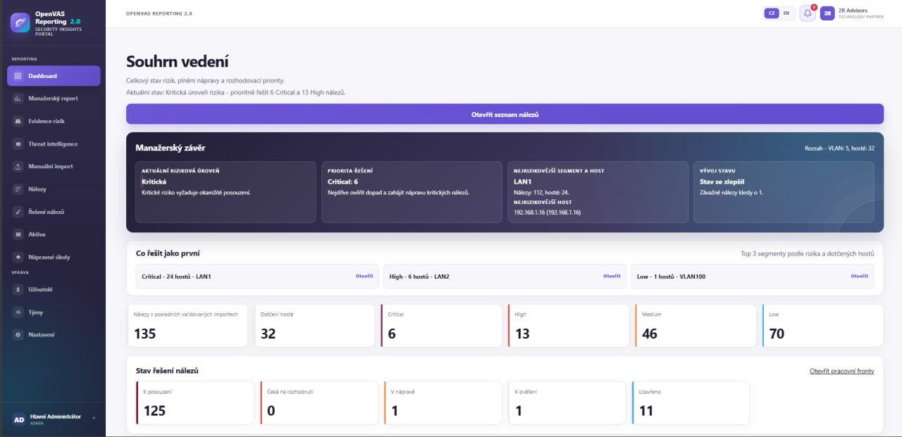

# Modern OpenVAS Reporting 2.0

**Turn OpenVAS scan results into a managed vulnerability remediation process.**

Modern OpenVAS Reporting 2.0 is a commercial vulnerability reporting, prioritisation and remediation platform developed by [2R Advisors](https://www.2radvisors.cz/). It extends the operational use of OpenVAS scan results with threat intelligence, risk-based prioritisation, ownership, remediation workflows, risk acceptance and management reporting.

> This repository is a product information repository. It does **not** contain source code, binaries, deployment packages or a licence to use the software.

## Why it exists

A vulnerability scan identifies technical findings. Organisations still need to decide:

- which findings require immediate attention;
- which assets and business environments are affected;
- who owns assessment, approval and remediation;
- whether remediation has actually succeeded;
- when a risk may be accepted and under which conditions;
- what management and auditors need to see.

Modern OpenVAS Reporting 2.0 brings these activities into one controlled workflow.

## Product capabilities

### Automated OpenVAS imports

Completed reports can be collected from configured OpenVAS tasks and mapped to networks, VLANs and organisational scopes. Repeated occurrences are correlated across imports while historical evidence remains available.

### Threat intelligence enrichment

Findings can be enriched with CVE metadata, EPSS probability, CISA Known Exploited Vulnerabilities information and public exploit intelligence. Enrichment focuses attention on vulnerabilities that are likely to matter in the current threat landscape.

### Context-aware risk scoring

Prioritisation combines technical severity with exploitability and source context, including internet exposure, network type and operating environment. The original OpenVAS severity remains visible alongside the calculated risk score.

### End-to-end remediation workflow

The platform supports assessment, remediation proposals, approval, assignment to responsible teams, remediation work, verification and closure. Findings that disappear from a subsequent validated scan can be closed as remediated according to the configured process.

### Risk acceptance register

Risk acceptance is handled as a controlled decision with justification, compensating controls, ownership, validity and review dates. Accepted risks remain visible to management and auditors.

### Roles, teams and responsibility scopes

Role-based access separates administration, security assessment, asset ownership, remediation, management and audit activities. Teams can be assigned responsibility for selected networks, subnets, hosts and technology scopes.

### Management and audit reporting

Dashboards and reports present current risk, remediation status, overdue work, affected assets and accepted risks. Audit history records relevant decisions and workflow changes.

### Operational administration

Administrators can manage OpenVAS sources, automation, threat intelligence feeds, risk calculation, retention, notifications, SMTP settings, access controls and other operating parameters through the web interface.

### Czech and English interface

The user interface supports Czech and English for multinational or mixed-language teams.

## Deployment model

Modern OpenVAS Reporting 2.0 is designed for deployment in the customer's controlled infrastructure. OpenVAS remains the vulnerability scanner; the platform consumes and enriches its results and manages the subsequent remediation lifecycle.

Deployment scope, integration, roles, workflows and licensing are agreed for each customer environment.

## Commercial licensing

Modern OpenVAS Reporting 2.0 is proprietary commercial software. Access to the product, deployment artefacts, updates, support and usage rights requires a separate written agreement with 2R Advisors s.r.o.

See [LICENSE.md](LICENSE.md) for the repository terms. Commercial terms and pricing are available on request.

## Product information and contact

- Product page: [2radvisors.cz/openvas-reporting](https://www.2radvisors.cz/openvas-reporting/)
- Company: [2R Advisors](https://www.2radvisors.cz/)
- Contact: [2radvisors.cz/kontakt](https://www.2radvisors.cz/kontakt/)
- Email: [info@2radvisors.cz](mailto:info@2radvisors.cz)
- LinkedIn: [2R Advisors](https://www.linkedin.com/company/2r-advisors-sro/)

## Documentation in this repository

- [Product overview](docs/product-overview.md)
- [Commercial licence notice](LICENSE.md)
- [Support information](SUPPORT.md)
- [Security contact](SECURITY.md)
- [Trademark notice](TRADEMARKS.md)

## Trademark notice

OPENVAS is a trademark of Greenbone AG. Modern OpenVAS Reporting 2.0 is an independent product of 2R Advisors s.r.o. It is not an official Greenbone product and is not affiliated with, sponsored by or endorsed by Greenbone AG. See [TRADEMARKS.md](TRADEMARKS.md).
